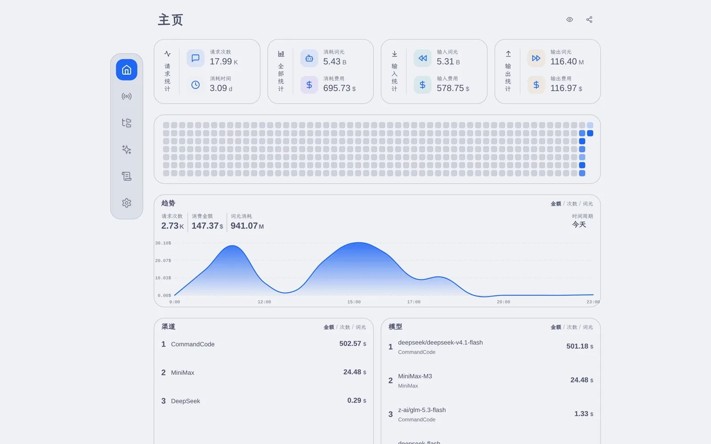
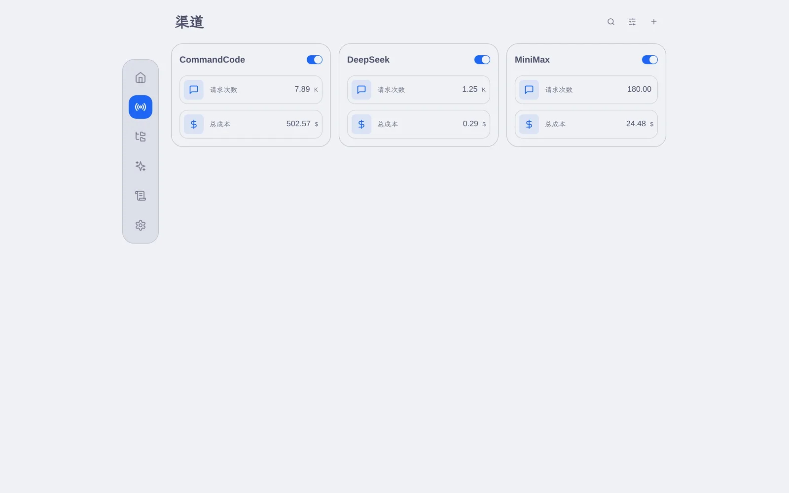
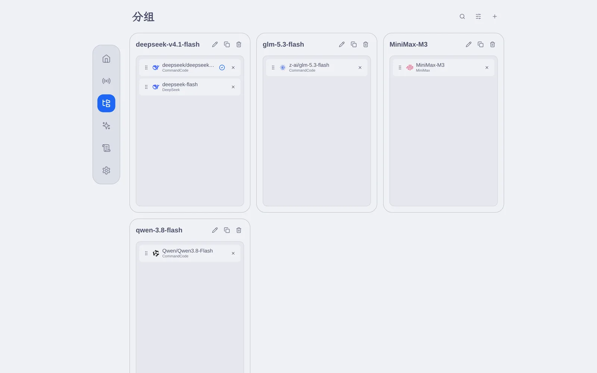
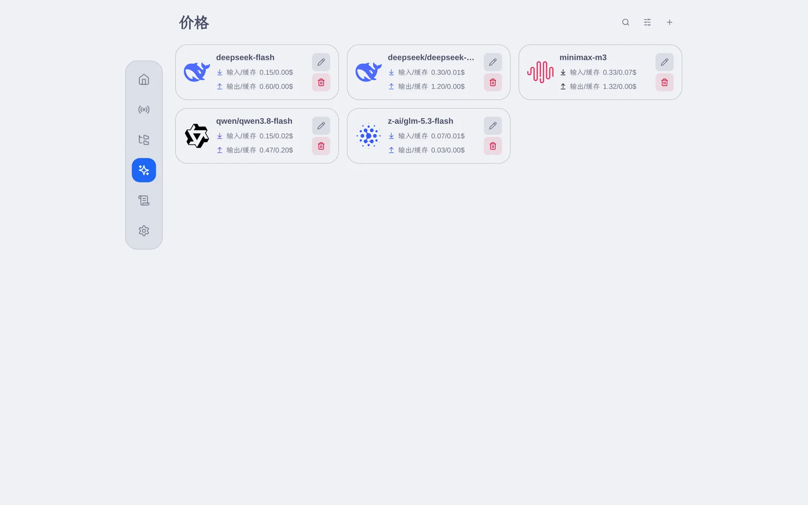
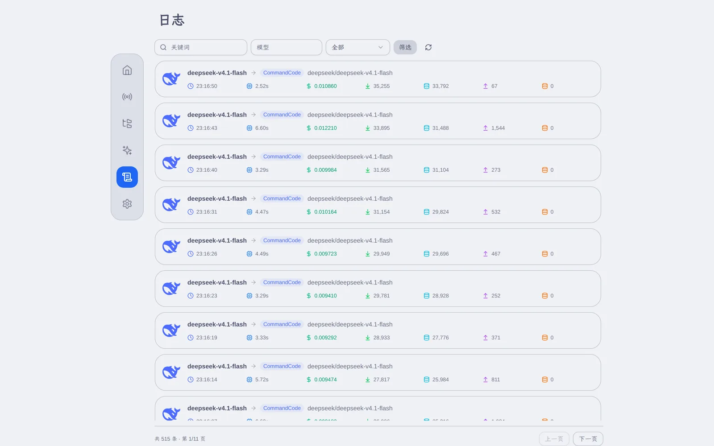
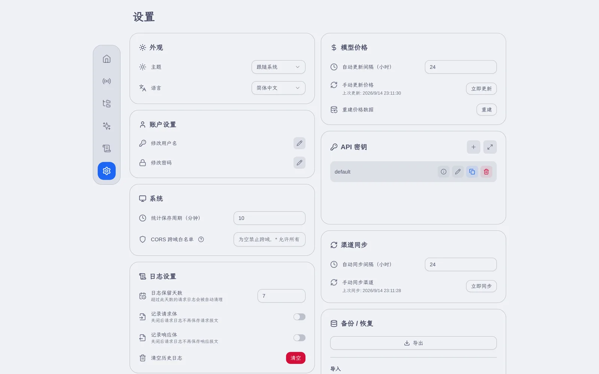
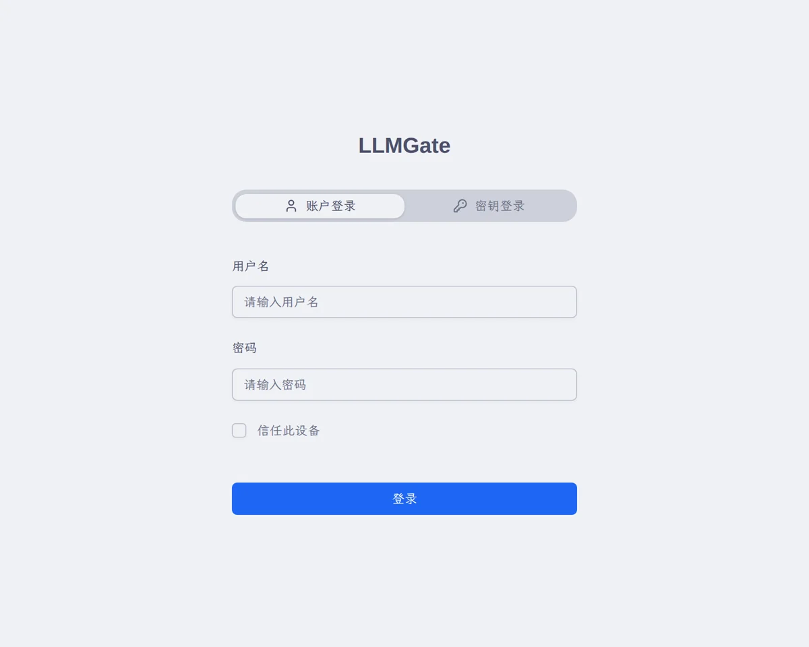
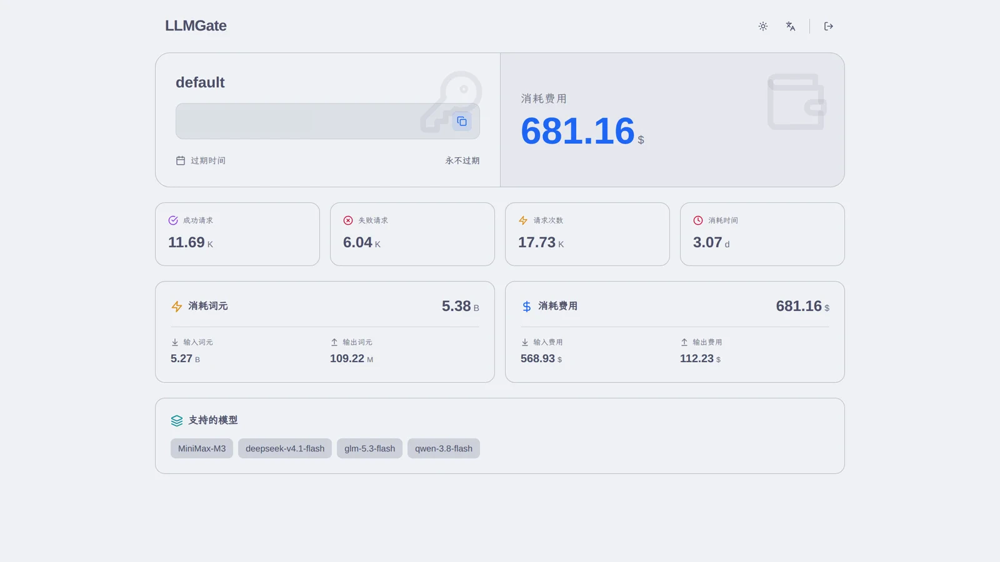
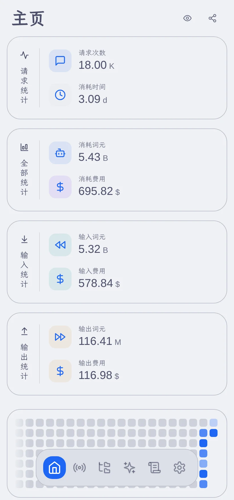
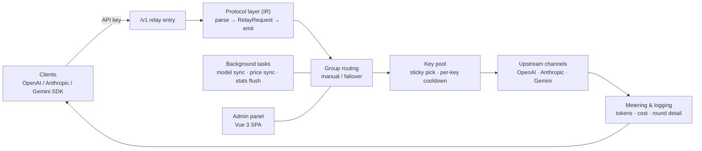

<div align="center">

# LLMGate

**An all-in-one AI gateway — protocol translation · grouped failover · usage metering**

[简体中文](README.md) | English | [日本語](README.ja.md)

[](LICENSE)
[](rust-toolchain.toml)
[](web)
[](#-quick-start)
[](src/db/mod.rs)

</div>

---

## Overview

LLMGate is a personal LLM API aggregation gateway written in Rust. It gathers your scattered upstream channels behind a single API entry point, exposes the OpenAI / Anthropic / Gemini client protocols with free conversion between them, and ships with full usage metering and a visual admin panel.

- **One endpoint**: every upstream channel shares one `base_url` and one set of API keys; clients never need to know which vendor sits behind it.
- **Single binary**: the frontend build is embedded into the executable at compile time via `rust-embed`, so the only runtime dependency is a SQLite database file — `scp` one file and you are deployed.
- **Translation through an IR**: the four wire formats are never converted pairwise; everything is routed through an intermediate representation, so adding a format means writing one parser plus one emitter.
- **Panel built in**: request logs, channel metrics, model pricing and backup/restore all live in the same process, with no external middleware.

## ✨ Features

### Protocol & relay

- **Any-to-any conversion across four formats**: OpenAI Chat Completions, OpenAI Responses, Anthropic Messages and Google Gemini GenerateContent, all normalised into `RelayRequest` / `RelayResponse` / `StreamEvent`.
- **Streaming and non-streaming share one path**: SSE streams and one-shot JSON responses are driven by the same IR logic, with client-specific headers such as `anthropic-beta` passed through.
- **Lossy conversion made explicit**: fields the upstream does not support are dropped in the emitter, and anything that cannot be modelled is carried explicitly as `ContentPart::Unknown` — never silently discarded.
- **Session ID switch**: a channel can opt in per-channel with a header name, and every request then carries an ID that is stable for the whole conversation (a client-supplied header of the same name wins; otherwise the ID is derived from the caller identity plus the conversation prefix). Upstreams such as OpenCode Go that require `x-opencode-session` get the routing and prompt-cache affinity they expect.

### Routing & resilience

- **Two group modes**: `manual` (pinned to one channel item) and `failover` (priority-ordered degradation).
- **Channel-level cooldown**: `401 / 403 / 404 / 429 / 5xx` responses and network timeouts cool down that channel item (300s by default) and move on to the next candidate.
- **Key pools**: a single channel may hold multiple keys (newline- or comma-separated). Selection is sticky by priority to improve upstream cache hits, while `401 / 403 / 429` only cools down the individual key and falls through to the next one.
- **Retryability check**: `400 / 422` are treated as client syntax errors and returned immediately instead of burning other candidates.
- **Probing**: when every healthy channel is cooling down, the one whose cooldown ends first is probed, so a whole group never goes dark.

### Metering & auditing

- **Cost accounting**: input, output, cache-read and cache-write tokens are priced separately against a catalogue synced from [models.dev](https://models.dev/api.json), with per-model multipliers and manual price rebuilding.
- **Multi-dimensional stats**: totals, daily, hourly and per-API-key aggregate tables, surfaced as trend charts, channel/model leaderboards and an activity heatmap.
- **Full request audit**: every forwarded request keeps its URL, headers, body, response headers, response body, latency, cost and **the detail of every retry round**, with separate toggles for persisting request/response bodies.
- **Live views**: log overview and group runtime state are pushed over SSE, so in-flight requests and cooldown countdowns update without refreshing.

### Panel & operations

- **Channel sync**: channels with `auto_sync` enabled pull the upstream `/models` list on a schedule and merge it in — manually added models are never overwritten.
- **Backup & restore**: one-click JSON export (with format version and timestamp); import merges by ID inside a transaction, tolerates per-row failures, and rebuilds in-memory caches afterwards.
- **Themes & languages**: Simplified Chinese / Traditional Chinese / English, light and dark themes, and a bottom floating navigation on mobile.
- **API key dashboard**: key holders can log in with their key alone to a read-only dashboard showing quota, usage and available models — no admin account required.

## 🖼 Screenshots

<table>
<tr>
<td width="50%" align="center"><b>Dashboard</b><br/></td>
<td width="50%" align="center"><b>Channels</b><br/></td>
</tr>
<tr>
<td width="50%" align="center"><b>Groups</b><br/></td>
<td width="50%" align="center"><b>Model pricing</b><br/></td>
</tr>
<tr>
<td width="50%" align="center"><b>Request logs</b><br/></td>
<td width="50%" align="center"><b>Settings</b><br/></td>
</tr>
<tr>
<td width="50%" align="center"><b>Login</b><br/></td>
<td width="50%" align="center"><b>API key dashboard</b><br/></td>
</tr>
</table>

<div align="center">

<br/>
<b>Mobile</b>
</div>

## 🏗 Architecture



```
├── src/
│   ├── conf/          # CLI arguments and global constants
│   ├── db/            # SQLite schema, connection pool, seed data
│   ├── model/         # Entities (channel / group / model / log / stats)
│   ├── op/            # Operations layer and in-memory caches (DB is the source of truth)
│   ├── relay/         # Relay core: pipeline / route / upstream / IR / SSE
│   │   └── ir/        # Parsers and emitters for the four protocol formats
│   ├── server/        # Axum routes, auth middleware, embedded static assets
│   └── task/          # Scheduled work: model sync, price sync, log cleanup, cache refresh
├── web/               # Vue 3 + Vite + Tailwind admin panel
└── static/out/        # Frontend build output (embedded at compile time via rust-embed)
```

## 🚀 Quick Start

### Requirements

- Rust **nightly** (pinned by the repository's `rust-toolchain.toml`; `rustup` switches automatically)
- Node.js 20+ and pnpm (only needed to build the frontend)

### Build and run

```bash
git clone https://github.com/waittide/llmgate.git
cd llmgate

# 1. Build the frontend (output lands in static/out, so it must run before the Rust build embeds it)
cd web && pnpm install && pnpm run build && cd ..

# 2. Build the backend (the frontend output is embedded into the binary at compile time)
cargo build --release

# 3. Run
./target/release/lg
```

Then open <http://localhost:8080>. The first launch creates the admin account automatically:

| Username | Password |
| :--- | :--- |
| `admin` | `admin` |

> ⚠️ Change both the username and the password under "Settings → Account" right after your first login.

### Command-line options

| Option | Description | Default |
| :--- | :--- | :--- |
| `--host` | Listen address | `0.0.0.0` |
| `-p`, `--port` | Listen port | `8080` |
| `-d`, `--data-dir` | Directory for the database and files | `data` |
| `--debug` | Emit debug-level logs | off |

The database lives at `{data_dir}/data.db` (WAL mode, so `data.db-wal` / `data.db-shm` appear next to it). On `SIGINT` / `SIGTERM` the process flushes in-memory statistics to disk first, then waits a bounded time for background tasks to exit.

## 🔌 Client Setup

Once channels and groups are configured, point a client at the gateway and authenticate with an API key issued by the panel. Four key transports are accepted: `x-api-key`, `Authorization: Bearer`, `x-goog-api-key`, and the `?key=` query parameter.

```bash
# OpenAI Chat Completions
curl http://localhost:8080/v1/chat/completions \
  -H 'Authorization: Bearer <API_KEY>' \
  -H 'Content-Type: application/json' \
  -d '{"model":"<model name in your group>","messages":[{"role":"user","content":"hi"}]}'

# OpenAI Responses
curl http://localhost:8080/v1/responses -H 'Authorization: Bearer <API_KEY>' -d '{...}'

# Anthropic Messages (the Anthropic SDK/CLI works directly with base_url set to /v1)
curl http://localhost:8080/v1/messages \
  -H 'x-api-key: <API_KEY>' \
  -H 'anthropic-version: 2023-06-01' \
  -d '{"model":"<model name>","max_tokens":1024,"messages":[{"role":"user","content":"hi"}]}'

# Gemini native (both mount points are equivalent; pick the one matching your base_url habit)
curl 'http://localhost:8080/v1beta/models/<model>:generateContent' \
  -H 'x-goog-api-key: <API_KEY>' -d '{"contents":[{"parts":[{"text":"hi"}]}]}'
curl 'http://localhost:8080/v1/v1beta/models/<model>:streamGenerateContent?alt=sse' \
  -H 'x-goog-api-key: <API_KEY>' -d '{"contents":[{"parts":[{"text":"hi"}]}]}'

# Available models
curl http://localhost:8080/v1/models -H 'Authorization: Bearer <API_KEY>'
```

## 🧭 Channels · Groups · Models

Routing is described by three configuration layers: **channels** (how to reach an upstream) → **models** (what a channel serves) → **groups** (which name is exposed and in what order channels are chosen).

| Concept | Description |
| :--- | :--- |
| `channels` | Upstream type (`openai` / `openai_responses` / `anthropic` / `gemini`), `base_url`, key pool, custom headers, parameter override (`param_override`), session header (`session_header`), auto-sync flag |
| `channel_models` | Model entries under a channel; sourced either from auto-sync or added manually — manual entries are never overwritten by a sync |
| `groups` | The publicly exposed model name plus the routing mode (`manual` / `failover`) |
| `group_items` | Channel members of a group and their priorities; `failover` picks by ascending priority |

Retry and timeout parameters per group (`relay_config`, editable in the panel):

| Parameter | Default | Meaning |
| :--- | :--- | :--- |
| `member_max_attempts` | `2` | Maximum number of channels tried for one request |
| `member_retry_interval_seconds` | `1` | Delay between attempts |
| `member_non_stream_response_timeout_seconds` | `60` | Timeout for a non-streaming response |
| `member_stream_first_event_timeout_seconds` | `30` | Timeout for the first streaming event |
| `member_cooldown_seconds` | `300` | Cooldown for a failed channel item |

## 🗂 Data Model

| Table | Purpose |
| :--- | :--- |
| `users` / `settings` | Admin accounts; system settings key-value store |
| `api_keys` | Client keys with enabled flag, expiry, cost ceiling and model whitelist |
| `channels` / `channel_models` | Upstream channels and their models, each with seven metrics (input/output tokens, input/output cost, wait time, successes, failures) |
| `groups` / `group_items` | Groups, routing mode, members and priorities |
| `model_infos` | Model price catalogue (input / output / cache read / cache write) |
| `stats_totals` / `stats_dailies` / `stats_hourlies` / `stats_api_keys` | Aggregated statistics in four dimensions |
| `request_logs` | Request audit log including per-round retry detail (`rounds_detail`) |

Background tasks: statistics flush every `stats_save_interval` (10 minutes by default); channel models and prices sync every `sync_model_interval` / `model_info_update_interval` (24 hours by default); expired logs are pruned hourly using `log_retention_days` (7 days by default); in-memory caches are fully refreshed every 5 minutes.

## 🛠 Admin API

Admin endpoints live under `/api/v1`. Administrators authenticate with a JWT (`Authorization: Bearer <token>`); the key dashboard authenticates with an API key.

| Resource | Endpoints |
| :--- | :--- |
| User | `POST /user/login`, `GET /user/status`, `POST /user/change-username`, `POST /user/change-password` |
| API keys | `GET /apikey/list`, `POST /apikey/create`, `POST /apikey/update`, `DELETE /apikey/delete/{id}`, `GET /apikey/login`, `GET /apikey/stats` |
| Channels | `GET /channel/list`, `POST /channel/create`, `POST /channel/update`, `POST /channel/enable`, `DELETE /channel/delete/{id}`, `POST /channel/fetch-model`, `POST /channel/sync`, `GET /channel/last-sync-time` |
| Groups | `GET /group/list`, `POST /group/create`, `POST /group/update`, `POST /group/active/{id}`, `DELETE /group/delete/{id}`, `GET /group/runtime/stream` (SSE) |
| Models | `GET /model/list`, `POST /model/create`, `POST /model/update`, `POST /model/delete`, `POST /model/update-price`, `POST /model/rebuild-price`, `GET /model/last-update-time` |
| Stats | `GET /stats/today`, `GET /stats/daily`, `GET /stats/hourly`, `GET /stats/total`, `GET /stats/apikey` |
| Logs | `GET /log/list`, `GET /log/{id}`, `GET /log/overview/stream` (SSE), `GET /log/{id}/request-body`, `GET /log/{id}/response-body`, `POST /log/{id}/{round}/stop`, `DELETE /log/clear` |
| Settings & backup | `GET /setting/list`, `POST /setting/set`, `GET /setting/export`, `POST /setting/import` |

## 💻 Development

```bash
# Backend (listens on 8080 by default)
cargo run

# Frontend with hot reload (/api is proxied to 127.0.0.1:8080, override with VITE_PROXY_TARGET)
cd web && pnpm run dev
```

> In development builds `rust-embed` reads straight from `static/out/`, so re-running `pnpm run build` is enough to pick up frontend changes — no Rust rebuild required.

Gates that must all pass before a commit:

```bash
cargo fmt                                   # format per the repository's rustfmt.toml
cargo clippy --all-targets -- -D warnings   # zero warnings
cargo test                                  # full test suite
```

## 🙏 Acknowledgements

- The overall design — the channel/group/model configuration layers, the IR-based protocol translation approach, and the gateway-with-panel-in-one-process shape — draws on [bestruirui/octopus](https://github.com/bestruirui/octopus). Thanks to its author. LLMGate is an independent Rust implementation, not a fork.
- Model pricing data comes from [models.dev](https://models.dev).

## 📄 License

[MIT](LICENSE) © 2026 waittide
