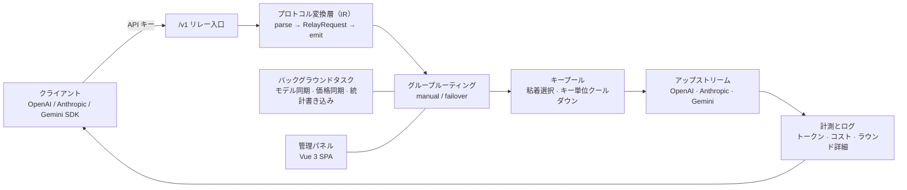

<div align="center">

# LLMGate

**オールインワン AI ゲートウェイ —— プロトコル相互変換 · グループ冗長化 · 利用量の計測**

[简体中文](README.md) | [English](README.en.md) | 日本語

[](LICENSE)
[](rust-toolchain.toml)
[](web)
[](#-クイックスタート)
[](src/db/mod.rs)
[](https://github.com/waittide/llmgate/pkgs/container/llmgate)

</div>

---

## 概要

LLMGate は Rust で書かれた個人向けの LLM API 集約ゲートウェイです。散らばりがちな複数のアップストリームチャネルを 1 つの API エントリにまとめ、クライアント側には OpenAI / Anthropic / Gemini の 3 系統のプロトコルを公開し、相互に自由に変換します。利用量の計測と管理パネルも本体に同梱されています。

- **入口は 1 つ**: すべてのアップストリームが 1 つの `base_url` と 1 セットの API キーを共有するため、クライアントは背後がどのベンダーかを意識する必要がありません。
- **単一バイナリ**: フロントエンドのビルド成果物はコンパイル時に `rust-embed` で実行ファイルへ埋め込まれます。実行時に必要なのは SQLite のデータベースファイルだけなので、ファイルを 1 つ `scp` すれば配備は完了します。
- **変換は IR 経由**: 4 つのワイヤーフォーマット同士を個別に変換するのではなく、すべて中間表現（IR）を経由します。フォーマットを追加するときは parser と emitter を 1 つずつ書くだけです。
- **パネルも同一プロセス**: リクエストログ、チャネル指標、モデル価格、バックアップ／復元がすべて同一プロセスに同居し、外部ミドルウェアは不要です。

## ✨ 機能

### プロトコルとリレー

- **4 フォーマットの任意相互変換**: OpenAI Chat Completions、OpenAI Responses、Anthropic Messages、Google Gemini GenerateContent を `RelayRequest` / `RelayResponse` / `StreamEvent` に正規化します。
- **ストリーミングと一括応答が同一経路**: SSE ストリームと単発 JSON 応答は同じ IR ロジックで処理され、`anthropic-beta` などのクライアント固有ヘッダーも透過します。
- **非可逆変換を明示**: アップストリームが対応しないフィールドは emitter 側で明示的に破棄し、表現できない内容は `ContentPart::Unknown` として明示的に保持します（暗黙の欠落はさせません）。

### ルーティングと耐障害性

- **グループの 2 モード**: `manual`（特定のチャネル項目に固定）と `failover`（優先度順に降格）。
- **チャネル単位のクールダウン**: `401 / 403 / 404 / 429 / 5xx` およびネットワークタイムアウトで該当チャネル項目をクールダウン（既定 300 秒）し、次の候補へ自動的に切り替えます。
- **キープール**: 1 つのチャネルに複数のキー（改行またはカンマ区切り）を登録できます。キャッシュヒット率を上げるため優先度に従った粘着選択を行い、`401 / 403 / 429` では該当キーだけをクールダウンして次のキーへ順送りします。
- **再試行可否の判定**: `400 / 422` はクライアント側の文法エラーとして即座に返し、他の候補を無駄に消費しません。
- **プロービング**: 健全なチャネルがすべてクールダウン中の場合は、最も早く復帰する項目を試行し、グループ全体が停止するのを防ぎます。

### 計測と監査

- **コスト計算**: 入力・出力・キャッシュ読み・キャッシュ書きの 4 種類のトークンを個別に課金計算します。価格カタログは [models.dev](https://models.dev/api.json) から自動同期し、モデルごとの倍率設定と手動での再構築にも対応します。
- **多次元の統計**: 合計・日次・時間別・API キー別の 4 種類の集計テーブルを持ち、推移グラフ、チャネル／モデルランキング、アクティビティヒートマップとして表示します。
- **完全なリクエスト監査**: 転送ごとに URL、ヘッダー、ボディ、レスポンスヘッダー、レスポンスボディ、所要時間、コスト、さらに**各リトライラウンドの詳細**を保存します。リクエスト／レスポンスボディの保存可否は個別に切り替えられます。
- **リアルタイム表示**: ログ一覧とグループの稼働状態は SSE で配信されるため、更新操作なしで進行中のリクエストやクールダウンの残り時間が反映されます。

### パネルと運用

- **チャネル同期**: `auto_sync` を有効にしたチャネルは定期的にアップストリームの `/models` を取得してマージします。手動追加したモデルが上書きされることはありません。
- **バックアップ／復元**: JSON のワンクリックエクスポート（フォーマット版数と日時を含む）。インポートはトランザクション内で ID 単位にマージし、行単位の失敗を許容したうえでメモリキャッシュを再構築します。
- **テーマと言語**: 簡体字中国語 / 繁体字中国語 / 英語、ライトとダークのテーマに対応。モバイルでは下部のフローティングナビゲーションに切り替わります。
- **API キーダッシュボード**: API キーの保持者はキーだけで読み取り専用ダッシュボードにログインでき、割当量・利用量・利用可能モデルを確認できます。管理者アカウントは不要です。

## 🖼 スクリーンショット

<table>
<tr>
<td width="50%" align="center"><b>ダッシュボード</b><br/></td>
<td width="50%" align="center"><b>チャネル管理</b><br/></td>
</tr>
<tr>
<td width="50%" align="center"><b>グループ</b><br/></td>
<td width="50%" align="center"><b>モデル価格</b><br/></td>
</tr>
<tr>
<td width="50%" align="center"><b>リクエストログ</b><br/></td>
<td width="50%" align="center"><b>設定</b><br/></td>
</tr>
<tr>
<td width="50%" align="center"><b>ログイン</b><br/></td>
<td width="50%" align="center"><b>API キーダッシュボード</b><br/></td>
</tr>
</table>

<div align="center">

<br/>
<b>モバイル</b>
</div>

## 🏗 アーキテクチャ



```
├── src/
│   ├── conf/          # CLI 引数とグローバル定数
│   ├── db/            # SQLite スキーマ、コネクションプール、初期データ
│   ├── model/         # エンティティ（チャネル / グループ / モデル / ログ / 統計）
│   ├── op/            # 操作レイヤーとメモリキャッシュ（DB が唯一の正）
│   ├── relay/         # リレーの中核: pipeline / route / upstream / IR / SSE
│   │   └── ir/        # 4 フォーマットの parser と emitter
│   ├── server/        # Axum ルーティング、認証ミドルウェア、静的資産の埋め込み
│   └── task/          # 定期処理: モデル同期、価格同期、ログ削除、キャッシュ更新
├── web/               # Vue 3 + Vite + Tailwind の管理パネル
└── static/out/        # フロントエンド成果物（コンパイル時に rust-embed で埋め込み）
```

## 🚀 クイックスタート

### 必要な環境

- Rust **nightly**（リポジトリの `rust-toolchain.toml` で固定済み。`rustup` が自動で切り替えます）
- Node.js 20+ と pnpm（フロントエンドのビルド時のみ）

### ビルドと実行

```bash
git clone https://github.com/waittide/llmgate.git
cd llmgate

# 1. フロントエンドをビルド（成果物は static/out に出力。埋め込む Rust ビルドより先に実行する必要があります）
cd web && pnpm install && pnpm run build && cd ..

# 2. バックエンドをビルド（フロントエンド成果物がコンパイル時に埋め込まれます）
cargo build --release

# 3. 起動
./target/release/lg
```

起動後 <http://localhost:8080> を開きます。初回起動時に管理者アカウントが自動生成されます。

| ユーザー名 | パスワード |
| :--- | :--- |
| `admin` | `admin` |

> ⚠️ 初回ログイン後すぐに「設定 → アカウント」でユーザー名とパスワードを変更してください。

### Docker

イメージは GitHub Actions が自動でビルドし GHCR へ push します。`main` は `dev` をローリング更新（push のたびに更新し `sha-<コミット>` タグも付与）、日次スナップショットも `dev`（前回スナップショット以降にビルド入力が変わっていなければスキップ）、タグは対応するバージョン、セマンティックバージョンは `latest` も更新します。

```bash
# データはホストの ./data に置かれます。コンテナは uid/gid 1000 で動くので先に権限を付与
mkdir -p ./data && sudo chown -R 1000:1000 ./data

docker run -d --name llmgate \
  -p 8080:8080 \
  -e TZ=Asia/Shanghai \
  -v "$PWD/data:/data" \
  ghcr.io/waittide/llmgate:latest
```

リポジトリ直下の `docker-compose.yml` が同じ内容です（`docker compose up -d`）。`image` を `build: .` に変えればソースからのビルドになります。

コンテナ内のデータディレクトリは `/data` で、ホストの任意のパスにマウントすれば永続化できます。コンテナ内のパスを変えたい場合は `-e LLMGATE_DATA_DIR=/other -v <ホスト側>:/other` を渡します。データベースは `/data/data.db`（WAL モードのため `-wal` / `-shm` が併存）で、バックアップはディレクトリごとコピーするだけです。起動時にデータディレクトリが書き込み可能かを自己チェックし、所有者が違う場合は実行すべき `chown` コマンドを示して即座に終了します。

### 起動オプション

| オプション | 説明 | 既定値 |
| :--- | :--- | :--- |
| `--host` | 待ち受けアドレス | `0.0.0.0` |
| `-p`, `--port` | 待ち受けポート | `8080` |
| `-d`, `--data-dir` | データベースとファイルの保存先（環境変数 `LLMGATE_DATA_DIR`） | `~/.config/llmgate` |
| `--debug` | Debug レベルのログ出力 | 無効 |

データディレクトリの既定値は `~/.config/llmgate` です（`HOME` が無い場合は相対パス `data` に退避します。`-d` または環境変数 `LLMGATE_DATA_DIR` で上書きでき、コンテナイメージでは同変数が `/data` に設定されています）。データベースは `{data_dir}/data.db` にあります（WAL モードのため `data.db-wal` / `data.db-shm` が併存します）。`SIGINT` / `SIGTERM` を受けると、まずメモリ上の統計をディスクへ書き出し、その後バックグラウンドタスクの終了を期限付きで待ちます。

## 🔌 クライアントからの利用

チャネルとグループを設定したら、クライアントは `base_url` をゲートウェイに向け、パネルで発行した API キーで認証するだけです。キーの渡し方は `x-api-key`、`Authorization: Bearer`、`x-goog-api-key`、クエリパラメータ `?key=` の 4 通りに対応します。

```bash
# OpenAI Chat Completions
curl http://localhost:8080/v1/chat/completions \
  -H 'Authorization: Bearer <API_KEY>' \
  -H 'Content-Type: application/json' \
  -d '{"model":"<グループ内のモデル名>","messages":[{"role":"user","content":"hi"}]}'

# OpenAI Responses
curl http://localhost:8080/v1/responses -H 'Authorization: Bearer <API_KEY>' -d '{...}'

# Anthropic Messages（base_url を /v1 に向ければ Anthropic SDK/CLI をそのまま利用できます）
curl http://localhost:8080/v1/messages \
  -H 'x-api-key: <API_KEY>' \
  -H 'anthropic-version: 2023-06-01' \
  -d '{"model":"<モデル名>","max_tokens":1024,"messages":[{"role":"user","content":"hi"}]}'

# Gemini ネイティブ（2 つのマウントポイントは等価。base_url の慣習に合わせて選択してください）
curl 'http://localhost:8080/v1beta/models/<モデル名>:generateContent' \
  -H 'x-goog-api-key: <API_KEY>' -d '{"contents":[{"parts":[{"text":"hi"}]}]}'
curl 'http://localhost:8080/v1/v1beta/models/<モデル名>:streamGenerateContent?alt=sse' \
  -H 'x-goog-api-key: <API_KEY>' -d '{"contents":[{"parts":[{"text":"hi"}]}]}'

# 利用可能なモデル一覧
curl http://localhost:8080/v1/models -H 'Authorization: Bearer <API_KEY>'
```

## 🧭 チャネル · グループ · モデル

ルーティングは 3 層の設定で決まります。**チャネル**（アップストリームへの接続方法）→ **モデル**（そのチャネルが提供するモデル）→ **グループ**（外部に公開する名前とチャネルの選択順）。

| 概念 | 説明 |
| :--- | :--- |
| `channels` | アップストリーム種別（`openai` / `openai_responses` / `anthropic` / `gemini`）、`base_url`、キープール、カスタムヘッダー、クライアントヘッダー透過リスト（`passthrough_header`、記載したヘッダーはそのまま転送）、パラメータ上書き（`param_override`）、自動同期の有無 |
| `channel_models` | チャネル配下のモデル。自動同期由来と手動追加があり、手動追加分が同期で上書きされることはありません |
| `groups` | 外部に公開するモデル名とルーティングモード（`manual` / `failover`） |
| `group_items` | グループに属するチャネルと優先度。`failover` は優先度の昇順に選択します |

グループ単位の再試行・タイムアウト設定（`relay_config`、パネルから変更可能）:

| パラメータ | 既定値 | 意味 |
| :--- | :--- | :--- |
| `member_max_attempts` | `2` | 1 リクエストで試行するチャネルの最大数 |
| `member_retry_interval_seconds` | `1` | 試行間の待機時間 |
| `member_non_stream_response_timeout_seconds` | `60` | 非ストリーミング応答のタイムアウト |
| `member_stream_first_event_timeout_seconds` | `30` | ストリーミング初回イベントのタイムアウト |
| `member_cooldown_seconds` | `300` | 失敗したチャネル項目のクールダウン |

## 🗂 データモデル

| テーブル | 用途 |
| :--- | :--- |
| `users` / `settings` | 管理者アカウント、システム設定のキー・バリュー |
| `api_keys` | クライアントへ発行するキー（有効状態、有効期限、費用上限、モデル許可リスト） |
| `channels` / `channel_models` | アップストリームチャネルとそのモデル。それぞれ 7 項目の指標（入力／出力トークン、入力／出力費用、待機時間、成功／失敗回数）を保持 |
| `groups` / `group_items` | グループ、ルーティングモード、メンバーと優先度 |
| `model_infos` | モデル価格カタログ（入力 / 出力 / キャッシュ読み / キャッシュ書き） |
| `stats_totals` / `stats_dailies` / `stats_hourlies` / `stats_api_keys` | 4 次元の集計統計 |
| `request_logs` | リクエスト監査ログ。ラウンドごとの再試行詳細（`rounds_detail`）を含みます |

バックグラウンド処理: 統計は `stats_save_interval`（既定 10 分）ごとに書き出し、チャネルモデルと価格は `sync_model_interval` / `model_info_update_interval`（既定 24 時間）ごとに同期、期限切れログは `log_retention_days`（既定 7 日）に従って 1 時間ごとに削除、メモリキャッシュは 5 分ごとに全量更新します。

## 🛠 管理 API

管理用エンドポイントは `/api/v1` 配下にあります。管理者は JWT（`Authorization: Bearer <token>`）、キーダッシュボードは API キーで認証します。

| リソース | エンドポイント |
| :--- | :--- |
| ユーザー | `POST /user/login`、`GET /user/status`、`POST /user/change-username`、`POST /user/change-password` |
| API キー | `GET /apikey/list`、`POST /apikey/create`、`POST /apikey/update`、`DELETE /apikey/delete/{id}`、`GET /apikey/login`、`GET /apikey/stats` |
| チャネル | `GET /channel/list`、`POST /channel/create`、`POST /channel/update`、`POST /channel/enable`、`DELETE /channel/delete/{id}`、`POST /channel/fetch-model`、`POST /channel/sync`、`GET /channel/last-sync-time` |
| グループ | `GET /group/list`、`POST /group/create`、`POST /group/update`、`POST /group/active/{id}`、`DELETE /group/delete/{id}`、`GET /group/runtime/stream`（SSE） |
| モデル | `GET /model/list`、`POST /model/create`、`POST /model/update`、`POST /model/delete`、`POST /model/update-price`、`POST /model/rebuild-price`、`GET /model/last-update-time` |
| 統計 | `GET /stats/today`、`GET /stats/daily`、`GET /stats/hourly`、`GET /stats/total`、`GET /stats/apikey` |
| ログ | `GET /log/list`、`GET /log/{id}`、`GET /log/overview/stream`（SSE）、`GET /log/{id}/request-body`、`GET /log/{id}/response-body`、`POST /log/{id}/{round}/stop`、`DELETE /log/clear` |
| 設定とバックアップ | `GET /setting/list`、`POST /setting/set`、`GET /setting/export`、`POST /setting/import` |

## 💻 開発

```bash
# バックエンド（既定で 8080 を待ち受け）
cargo run

# フロントエンドのホットリロード（/api は 127.0.0.1:8080 へプロキシ。VITE_PROXY_TARGET で変更可）
cd web && pnpm run dev
```

> 開発ビルドでは `rust-embed` が `static/out/` から直接読み込むため、フロントエンドを変更したら `pnpm run build` を再実行するだけで反映されます（Rust の再ビルドは不要）。

コミット前に必ず通すゲート:

```bash
cargo fmt                                   # リポジトリの rustfmt.toml に従って整形
cargo clippy --all-targets -- -D warnings   # 警告ゼロ
cargo test                                  # 全テスト
```

## 🙏 謝辞

- 全体設計（チャネル／グループ／モデルの 3 層設定、IR によるプロトコル変換の考え方、ゲートウェイとパネルを同一プロセスに置く構成）は [bestruirui/octopus](https://github.com/bestruirui/octopus) を参考にしています。作者に感謝します。LLMGate は独立した Rust 実装であり、フォークではありません。
- モデル価格データは [models.dev](https://models.dev) を利用しています。

## 📄 ライセンス

[MIT](LICENSE) © 2026 waittide
