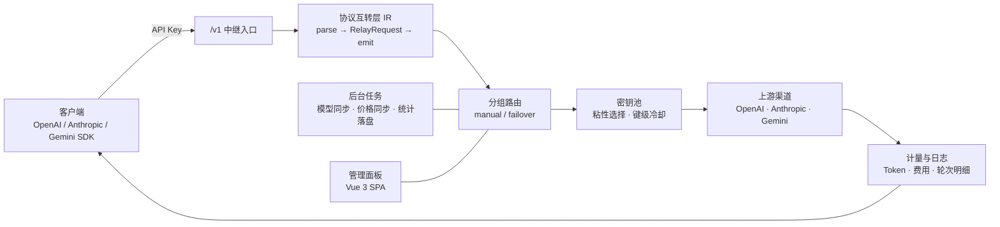

<div align="center">

# LLMGate

**全能 AI 服务网关 —— 多协议互转 · 分组容灾 · 用量计量**

简体中文 | [English](README.en.md) | [日本語](README.ja.md)

[](LICENSE)
[](rust-toolchain.toml)
[](web)
[](#-快速开始)
[](src/db/mod.rs)

</div>

---

## 简介

LLMGate 是一个用 Rust 编写的个人 LLM API 聚合网关：把手上零散的模型渠道收拢成一个统一的 API 入口，向下游暴露 OpenAI / Anthropic / Gemini 三种客户端协议，任意协议之间可自由互转，并自带一套完整的用量计量与可视化管理面板。

- **一个入口**：所有上游渠道共用一个 `base_url` 与一套 API Key，客户端无需关心背后是哪个厂商。
- **单二进制**：前端产物在编译期由 `rust-embed` 内嵌进可执行文件，运行时依赖只有 SQLite 数据库文件，`scp` 一个文件即可部署。
- **协议互转走 IR**：四种线上格式之间不是两两直连转换，全部经中间表示层（IR）中转，新增一种格式只需一个 parser + 一个 emitter。
- **面板即后端**：请求日志、渠道指标、模型价格、备份恢复全部在同一进程内，无外部中间件。

## ✨ 特性

### 协议与中继

- **四种格式任意互转**：OpenAI Chat Completions、OpenAI Responses、Anthropic Messages、Google Gemini GenerateContent（`ApiFormat` 四类，经 `RelayRequest` / `RelayResponse` / `StreamEvent` 统一表示）。
- **流式与整包同源**：SSE 流式响应与一次性 JSON 响应由同一套 IR 逻辑驱动，附带上游 `anthropic-beta` 等客户端特征头透传。
- **有损转换显式化**：上游不支持的字段在 emitter 侧显式丢弃，无法建模的内容以 `ContentPart::Unknown` 显式携带，不做静默丢弃。
- **会话标识开关**：渠道可开启「分配会话标识」并指定头名，每轮请求携带一个按会话稳定的 ID（客户端自带同名头则沿用其值，否则按「身份 + 会话前缀」推导，同一会话各轮一致）；OpenCode Go 这类要求 `x-opencode-session` 的上游据此完成路由与提示缓存亲和。

### 路由与容灾

- **分组两种模式**：`manual`（固定指向某个渠道项）与 `failover`（按优先级顺位降级）。
- **渠道级冷却**：`401 / 403 / 404 / 429 / 5xx` 与网络超时触发该渠道项冷却（默认 300s），自动切换到下一个候选。
- **密钥池**：单渠道可填多个 Key（换行或逗号分隔），粘性优先级使用以提升上游缓存命中，遇到 `401 / 403 / 429` 只冷却单个 Key 并顺延下一个。
- **可重试性判定**：`400 / 422` 视为客户端语法错误立即返回，不浪费候选渠道。
- **灰度探活**：所有健康渠道都在冷却时，挑选冷却最早结束的一项试探，避免整组不可用。

### 计量与审计

- **费用核算**：输入 / 输出 / 缓存读 / 缓存写四类 Token 分别计价，价格目录与 [models.dev](https://models.dev/api.json) 自动同步，支持按模型自定义倍率与手工重建价格。
- **多维度统计**：总量、按天、按小时、按 API Key 四张聚合表，面板提供趋势折线、渠道/模型排行与活跃度热力图。
- **完整请求审计**：每条转发记录保存请求 URL、请求头、请求体、响应头、响应体、耗时、费用与**每一轮重试的明细**，并可按开关决定是否落盘报文体。
- **实时视图**：日志总览与分组运行状态都通过 SSE 推送，面板无需刷新即可看到在途请求与冷却倒计时。

### 面板与运维

- **渠道同步**：开启 `auto_sync` 的渠道按周期拉取上游 `/models`，自动合并模型列表（手工添加的模型不会被覆盖）。
- **备份恢复**：一键导出 JSON（含版本号与导出时间），导入时按 ID 事务合并、逐行容错，完成后自动重建内存缓存。
- **多语言与主题**：面板支持简体中文 / 繁體中文 / English 与浅色 / 深色主题，移动端自动切换为底部悬浮导航。
- **API Key 自助看板**：API Key 持有者可用 Key 直接登录一个只读看板，查看自己的额度、用量与可用模型，无需管理员账号。

## 🖼 界面预览

<table>
<tr>
<td width="50%" align="center"><b>主页总览</b><br/></td>
<td width="50%" align="center"><b>渠道管理</b><br/></td>
</tr>
<tr>
<td width="50%" align="center"><b>分组路由</b><br/></td>
<td width="50%" align="center"><b>模型价格</b><br/></td>
</tr>
<tr>
<td width="50%" align="center"><b>请求日志</b><br/></td>
<td width="50%" align="center"><b>系统设置</b><br/></td>
</tr>
<tr>
<td width="50%" align="center"><b>登录</b><br/></td>
<td width="50%" align="center"><b>API Key 看板</b><br/></td>
</tr>
</table>

<div align="center">

<br/>
<b>移动端</b>
</div>

## 🏗 架构



```
├── src/
│   ├── conf/          # CLI 参数与全局常量
│   ├── db/            # SQLite 建表、连接池与默认数据
│   ├── model/         # 实体定义（渠道 / 分组 / 模型 / 日志 / 统计）
│   ├── op/            # 业务操作层与内存缓存（数据库为唯一事实源）
│   ├── relay/         # 中继核心：pipeline / route / upstream / IR / SSE
│   │   └── ir/        # 四种协议格式的 parser 与 emitter
│   ├── server/        # Axum 路由、鉴权中间件、静态资源内嵌
│   └── task/          # 定时任务：模型同步、价格同步、日志清理、缓存刷新
├── web/               # Vue 3 + Vite + Tailwind 管理面板
└── static/out/        # 前端构建产物（由 rust-embed 在编译期内嵌）
```

## 🚀 快速开始

### 前置要求

- Rust **nightly**（仓库内 `rust-toolchain.toml` 已固定，`rustup` 会自动切换）
- Node.js 20+ 与 pnpm（仅构建前端需要）

### 编译与运行

```bash
git clone https://github.com/waittide/llmgate.git
cd llmgate

# 1. 构建前端（产物落到 static/out，必须在内嵌它的 Rust 编译之前完成）
cd web && pnpm install && pnpm run build && cd ..

# 2. 构建后端（前端产物在编译期内嵌进二进制）
cargo build --release

# 3. 启动
./target/release/lg
```

启动后访问 <http://localhost:8080>，首次运行会自动创建管理员账号：

| 用户名 | 密码 |
| :--- | :--- |
| `admin` | `admin` |

> ⚠️ 首次登录后请立即在「设置 → 账户」中修改用户名与密码。

### 启动参数

| 参数 | 说明 | 默认值 |
| :--- | :--- | :--- |
| `--host` | 监听地址 | `0.0.0.0` |
| `-p`, `--port` | 监听端口 | `8080` |
| `-d`, `--data-dir` | 数据库与文件存储目录 | `data` |
| `--debug` | 输出 Debug 级别日志 | 关闭 |

数据库文件位于 `{data_dir}/data.db`（WAL 模式，同时存在 `data.db-wal` / `data.db-shm`）。进程收到 `SIGINT` / `SIGTERM` 时会先把内存中的统计增量落盘，再限时等待后台任务退出。

## 🔌 客户端接入

把渠道与分组配置好之后，客户端只需把 `base_url` 指向网关、用面板签发的 API Key 鉴权即可。API Key 支持四种传递方式：`x-api-key`、`Authorization: Bearer`、`x-goog-api-key`、查询参数 `?key=`。

```bash
# OpenAI Chat Completions
curl http://localhost:8080/v1/chat/completions \
  -H 'Authorization: Bearer <API_KEY>' \
  -H 'Content-Type: application/json' \
  -d '{"model":"<分组中的模型名>","messages":[{"role":"user","content":"hi"}]}'

# OpenAI Responses
curl http://localhost:8080/v1/responses -H 'Authorization: Bearer <API_KEY>' -d '{...}'

# Anthropic Messages（可直接用 Anthropic SDK/CLI，把 base_url 指到 /v1）
curl http://localhost:8080/v1/messages \
  -H 'x-api-key: <API_KEY>' \
  -H 'anthropic-version: 2023-06-01' \
  -d '{"model":"<模型名>","max_tokens":1024,"messages":[{"role":"user","content":"hi"}]}'

# Gemini 原生（两种挂载点等价，按客户端的 base_url 习惯任选）
curl 'http://localhost:8080/v1beta/models/<模型名>:generateContent' \
  -H 'x-goog-api-key: <API_KEY>' -d '{"contents":[{"parts":[{"text":"hi"}]}]}'
curl 'http://localhost:8080/v1/v1beta/models/<模型名>:streamGenerateContent?alt=sse' \
  -H 'x-goog-api-key: <API_KEY>' -d '{"contents":[{"parts":[{"text":"hi"}]}]}'

# 可用模型列表
curl http://localhost:8080/v1/models -H 'Authorization: Bearer <API_KEY>'
```

## 🧭 渠道 · 分组 · 模型

LLMGate 的路由由三张配置表串起来：**渠道**（上游怎么连）→ **模型**（渠道里有哪些模型）→ **分组**（对外暴露哪个名字、按什么顺序选渠道）。

| 概念 | 说明 |
| :--- | :--- |
| 渠道 `channels` | 上游类型（`openai` / `openai_responses` / `anthropic` / `gemini`）、`base_url`、密钥池、自定义 Header、参数覆盖（`param_override`）、会话标识（`session_header`）、是否自动同步模型 |
| 模型 `channel_models` | 渠道下的模型条目，来源分为自动同步与手工添加；两者共存时手工条目不会被同步覆盖 |
| 分组 `groups` | 对外的模型名与路由模式（`manual` / `failover`） |
| 分组项 `group_items` | 分组内的渠道成员与优先级，`failover` 模式按优先级升序选择 |

分组的重试与超时参数（`relay_config`，面板可改）：

| 参数 | 默认值 | 含义 |
| :--- | :--- | :--- |
| `member_max_attempts` | `2` | 单次请求最多尝试的渠道数 |
| `member_retry_interval_seconds` | `1` | 两次尝试之间的间隔 |
| `member_non_stream_response_timeout_seconds` | `60` | 非流式整包响应超时 |
| `member_stream_first_event_timeout_seconds` | `30` | 流式首包超时 |
| `member_cooldown_seconds` | `300` | 失败渠道的冷却时长 |

## 🗂 数据表

| 表 | 用途 |
| :--- | :--- |
| `users` / `settings` | 管理员账号；系统设置键值对 |
| `api_keys` | 下发给客户端的密钥，含启用状态、过期时间、费用上限、可用模型白名单 |
| `channels` / `channel_models` | 上游渠道及其模型，各自带 7 项指标（输入/输出 Token、输入/输出费用、等待时长、成功/失败次数） |
| `groups` / `group_items` | 分组、路由模式、分组项与优先级 |
| `model_infos` | 模型价格目录（输入 / 输出 / 缓存读 / 缓存写） |
| `stats_totals` / `stats_dailies` / `stats_hourlies` / `stats_api_keys` | 四个维度的聚合统计 |
| `request_logs` | 请求审计日志，含每轮重试详情 `rounds_detail` |

后台任务：统计增量按 `stats_save_interval`（默认 10 分钟）落盘；渠道模型与价格按 `sync_model_interval` / `model_info_update_interval`（默认 24 小时）同步；过期日志每小时按 `log_retention_days`（默认 7 天）清理；内存缓存每 5 分钟全量补偿刷新一次。

## 🛠 管理 API

管理接口挂在 `/api/v1` 下，管理员用 JWT（`Authorization: Bearer <token>`）鉴权，API Key 看板用 Key 鉴权。

| 资源 | 接口 |
| :--- | :--- |
| 用户 | `POST /user/login`、`GET /user/status`、`POST /user/change-username`、`POST /user/change-password` |
| API Key | `GET /apikey/list`、`POST /apikey/create`、`POST /apikey/update`、`DELETE /apikey/delete/{id}`、`GET /apikey/login`、`GET /apikey/stats` |
| 渠道 | `GET /channel/list`、`POST /channel/create`、`POST /channel/update`、`POST /channel/enable`、`DELETE /channel/delete/{id}`、`POST /channel/fetch-model`、`POST /channel/sync`、`GET /channel/last-sync-time` |
| 分组 | `GET /group/list`、`POST /group/create`、`POST /group/update`、`POST /group/active/{id}`、`DELETE /group/delete/{id}`、`GET /group/runtime/stream`（SSE） |
| 模型 | `GET /model/list`、`POST /model/create`、`POST /model/update`、`POST /model/delete`、`POST /model/update-price`、`POST /model/rebuild-price`、`GET /model/last-update-time` |
| 统计 | `GET /stats/today`、`GET /stats/daily`、`GET /stats/hourly`、`GET /stats/total`、`GET /stats/apikey` |
| 日志 | `GET /log/list`、`GET /log/{id}`、`GET /log/overview/stream`（SSE）、`GET /log/{id}/request-body`、`GET /log/{id}/response-body`、`POST /log/{id}/{round}/stop`、`DELETE /log/clear` |
| 设置与备份 | `GET /setting/list`、`POST /setting/set`、`GET /setting/export`、`POST /setting/import` |

## 💻 开发

```bash
# 后端（默认监听 8080）
cargo run

# 前端热更新（/api 反代到 127.0.0.1:8080，可用 VITE_PROXY_TARGET 覆盖）
cd web && pnpm run dev
```

> 开发模式下 `rust-embed` 直接从 `static/out/` 读文件，改完前端重新 `pnpm run build` 即可生效，无需重编 Rust。

提交前门禁（三者全部通过才允许提交）：

```bash
cargo fmt                                   # 按仓库 rustfmt.toml 格式化
cargo clippy --all-targets -- -D warnings   # 零警告
cargo test                                  # 全量测试
```

## 🙏 致谢

- 本项目的整体设计（渠道 / 分组 / 模型三层配置、IR 协议互转思路、面板与网关同进程的形态）借鉴了 [bestruirui/octopus](https://github.com/bestruirui/octopus)，在此向原作者致谢。LLMGate 是独立的 Rust 实现，并非其分支。
- 模型价格数据来自 [models.dev](https://models.dev)。

## 📄 许可证

[MIT](LICENSE) © 2026 waittide
